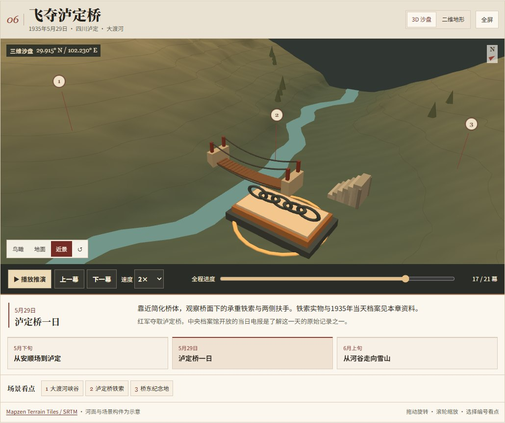

# 长征纪念馆 · 万里见证

纪念伟大的长征。

在浏览器中参观长征历史沙盘。七个展章分为 21 幕，使用 Three.js 在现代实测地形上呈现渡口、会议旧址、桥梁、雪山和草地。每幕都有对应的三维展件、观察说明和历史时间节点。



## 展览内容

| 展章 | 场景与内容 |
| --- | --- |
| 湘江战役 | 界首一带的湘江河谷、渡口示意与桂北纪念记忆 |
| 遵义会议 | 遵义老城地形、会址建筑与二楼会议室剖切示意 |
| 四渡赤水 | 土城古渡所在的赤水河谷与分段时间线 |
| 巧渡金沙江 | 皎平渡河谷、木船示意与当地船工的故事 |
| 强渡大渡河 | 安顺场河谷、渡船示意及从渡口到桥梁的历史脉络 |
| 飞夺泸定桥 | 大渡河峡谷、铁索桥示意与当日电报线索 |
| 爬雪山过草地 | 可切换的夹金山与日干乔草地地形，以及行军文物 |

## 操作沙盘

- 点击「播放推演」从当前幕连续观看至第 21 幕。支持暂停、续播、1× / 1.5× / 2× 倍速和逐幕前后切换。拖动「全程进度」可以跨章跳转，点击本章日期即可定位某一幕。地址栏会记录当前幕次，例如 `#chapter-luding/2` 对应泸定桥第二幕。
- 拖动旋转、滚轮或双指缩放，也可以在沙盘获得键盘焦点后用方向键和加减键观察。手动操作展章沙盘即暂停播放。点击「全屏」可同时放大场景和控制面板，支持该功能的浏览器会显示按钮。
- 切换幕次时展件、灯光和解说同步更新。例如泸定桥依次展示桥头、铁索展件和纪念展牌，雪山草地章还会切换到另一份实测高程。
- 点击场景编号或「场景看点」按钮阅读地点说明。系统启用减少动态效果时，连续播放保留静态视角。缺少 WebGL 2 时使用二维地形，仍可操作进度、看点、史料和路线筛选。
- 「路线总览」是可旋转的区域沙盘。选取队伍、拖动月份，可查看已出现的历史节点。点击对应的地图标记或列表链接可进入展章。虚线表示代表性地点的先后关系。

## 本地运行

需要 Node.js 20.19+（Node 20）或 22.12+（Node 22 及更新主版本），以及 npm。

```sh
npm ci
npm run dev
```

在浏览器打开终端显示的地址。运行以下命令可构建并预览发布版本。

```sh
npm run build
npm run preview
```

构建产物在 `dist/`，可部署到静态托管平台。Vite 使用相对资源路径，支持托管在子目录中。浏览时地形网格由同一站点提供，打开展章无需外部地图服务或 API 密钥。

## 数据、复原范围与署名

- **展章高程**使用 2000 年采集的 SRTM，数据由美国地质调查局提供，Mapzen 经 AWS Open Data 分发。八份局部网格均为 97×97 采样，由 z13 Terrarium 瓦片插值生成，单位为米。 [USGS SRTM](https://www.usgs.gov/centers/eros/science/usgs-eros-archive-digital-elevation-shuttle-radar-topography-mission-srtm-1) · [Mapzen Terrain Tiles](https://registry.opendata.aws/terrain-tiles/) · [数据署名](https://github.com/tilezen/joerd/blob/master/docs/attribution.md#srtm)
- **全程沙盘高程**使用独立的 97×97 区域网格。Mapzen z5 瓦片使用 USGS 的 GMTED2010 陆地高程与 NOAA 的 ETOPO1 水深数据。总览图在中部纬度的东西采样间距约 18 公里，南北间距约 16 公里。显示时放大高差，以便观察沿途地势。 [Mapzen 分级数据来源](https://github.com/tilezen/joerd/blob/master/docs/data-sources.md#what-is-sourced-at-what-zooms)
- **场景构件**包括建筑、河面、桥、船只和植被，均是为说明空间关系制作的示意模型。高程反映现代测量所见的区域地貌，场景几何和热点位置服务于展览阅读。皎平渡一带的高程采集早于乌东德水库蓄水。 [乌东德工程与皎平渡资料](https://wap.sasac.gov.cn/n2588025/n2588124/c36078420/content.html)
- **历史资料**在各章内列明出处。全程路线参考党史资料中的代表性地点和时间，地理位置采用近似点位。 [中央档案馆长征专题](https://www.saac.gov.cn/daj/yaow/202610/47471a679e6f4019ab4a0c7d2a1e02c8.shtml) · [中央党史和文献研究院长征专题](https://www.dswxyjy.org.cn/GB/427277/462086/index.html)

## 维护

| 路径 | 用途 |
| --- | --- |
| `src/chapters.js` | 展章、历史时间线、场景看点和资料链接 |
| `src/exhibit-phases.js` | 21 幕对应的展件主题、观察说明和雪山草地场景切换 |
| `src/main.js` | 跨章播放、逐幕定位、倍速、全屏和设备回退 |
| `src/scene.js` | Three.js 地形、场景构件、摄影机与交互 |
| `src/relief.js` | 从同一份高程生成二维晕渲与等高线 |
| `src/routes.js` | 四路路线示意、月份筛选与地点索引 |
| `src/route-stage.js` | 区域三维沙盘、节点拾取与相机控制 |
| `public/terrain/` | 八份展章网格与一份全程区域高程网格 |
| `scripts/generate-terrain.py` | 下载公开 Terrarium 高程瓦片并生成展区网格 |

站点构建直接使用仓库里的网格。需要重新取样时，联网执行以下命令。

```sh
python -m pip install Pillow
python scripts/generate-terrain.py
python scripts/generate-terrain.py --overview
```
